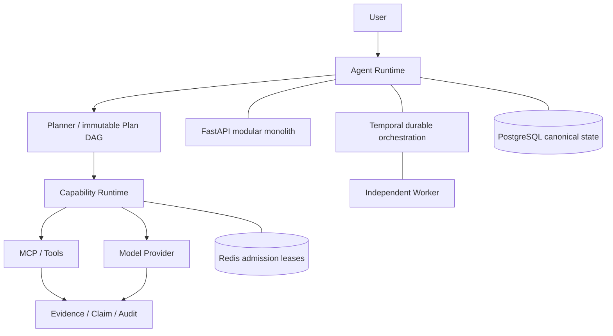

# Enterprise Agent Work Platform

企业级智能体工作平台，目标是让企业长任务在审批、权限、模型异常、Worker 崩溃和外部副作用条件下可靠执行。完整冻结需求保存在 `docs/spec/00-master-spec.md`。

**当前状态：Release Closure；生产 Chat/structured Provider、真实联网检索 Agent Task 与受控 Evaluation Gate 已通过，但仓库整体仍未达到 Definition of Done，不能声明 PROJECT COMPLETE。**

## 项目定位

这是一个面向企业长任务的可恢复、可治理、可审计 Agent Work Platform。它把模型调用放在确定性的权限、预算、状态、Evidence 和外部副作用边界内，以 PostgreSQL 保存权威业务事实，以 Temporal 编排耐久执行，并用独立 Worker 承担可恢复工作。

## 为什么不是 ChatGPT Wrapper

普通 Wrapper 通常把一次提示词和一次模型响应当成完整工作单元。本项目的权威状态不在模型上下文中：Task、不可变 Plan、Step、Attempt、Operation、Approval、Evidence、Claim、Usage 与 Audit 都有 Workspace 隔离的持久记录。外部写操作必须先绑定确切参数并获得 HITL；响应丢失进入 `UNKNOWN → Reconcile`，而不是盲目重试；Worker 崩溃后由 Temporal 和 PostgreSQL 记录恢复，已提交 Step 不重复执行。模型只能提出结构化结果，不能绕过 Policy 或把 Evidence 当作权限。

## Enterprise Agent Runtime 架构



主链路对应：`User → Agent Runtime → Planner → Capability Runtime → MCP / Tools 与 Model Provider → Evidence / Audit`。React Web 提供操作界面；Procurement MCP 使用独立数据库；MinIO 保存知识源和 Artifact 对象。

## 核心设计思想

- **事实与编排分离：** PostgreSQL 是权威状态，Temporal 只负责编排；Activity 读取或提交 canonical state。
- **副作用先治理后执行：** Capability Executor 统一执行 Schema、Policy、预算、循环守卫、Admission lease、Approval、Operation identity 与 fencing。
- **失败可判定：** 只在安全条件下重试；外部结果不确定时先 Reconcile；过期或 zombie Attempt 不能提交权威结果。
- **Evidence-first：** Evidence 不能授权操作；Claim 必须通过不可变、Workspace-scoped 链接回到原始 Evidence。
- **版本可还原：** ExecutionSnapshot、Plan、Skill、Capability Schema 和 Policy 版本共同定义可重放边界。

## 真实验证结果

- Production Task `0505362d-6cb2-4a03-94fb-abbb2d30dbab` 经 Procurement MCP 和 `Qwen/Qwen3.8-27B` 完成：2/2 Steps、2/2 Capability calls、2 Evidence、2 Evidence-linked Claims，2,298 tokens，48.277403 秒，0 Step retry。
- 真实联网检索 Task `8708638c-5cf9-4ff3-8484-0a363bb12e53` 在冷缓存下经 SearXNG、`web.search`、Qwen、Evidence 与 Trace 完成：3/3 Steps SUCCEEDED，27.502 秒端到端，其中检索 4.583 秒、模型生成 21.502 秒、审查 0.065 秒；3,779 tokens、5 Evidence、19 Trace nodes、0 retry。
- 最新 Evaluation run `b05d324f-8413-4dc7-8c11-448ba0dac7c7` 执行 72/72 Golden Task bindings，映射到 63 个去重节点且 63 passed；Evidence coverage 9/9、Claim provenance 9/9、Tool executions 41/41、Recovery 6/6。
- 真实故障验收覆盖 Worker kill/restart、`UNKNOWN → Reconcile` exactly-once Admission，以及真实 Redis 的 global/workspace/provider/capability/MCP Admission scopes。
- 详细记录见 [Production Agent Task Report](docs/release/PRODUCTION_AGENT_TASK_REPORT.md)、[Failure Recovery Case Report](docs/release/FAILURE_RECOVERY_CASE_REPORT.md) 和 `RELEASE_VALIDATION_REPORT.md`。

## 已知限制

生产 BGE、Reranker 与完整 streaming Chat UI 浏览器验收尚未完成；严格 FIFO/weighted Workspace fair queue 未实现；生产最小权限 service role 部署、取消补偿、Retention 实际删除、不可逆 Workspace/MinIO purge 仍未闭环。联网检索使用公开匿名上游，不具备商业搜索 SLA：DuckDuckGo 已真实返回，百度因 CAPTCHA 已从启用列表撤回，Bing/360 的可用性仍受外部限流影响。Task-specific Usage 尚未持久化 provider/model identity、input/output token 拆分和 HTTP transport retry 次数。历史失败记录继续保留。

## Quick Start

Windows：

```powershell
.\start.cmd
```

脚本检查 Docker，复用现有 Compose 架构完成构建、迁移、启动和健康等待，并输出全部服务状态。启动成功后访问：

- Web：<http://localhost:55173>
- API：<http://localhost:58080/docs>

停止完整环境但保留 PostgreSQL、Procurement DB、MinIO 和其他数据卷：

```powershell
.\stop.cmd
```

详细启动流程、Provider 容器网络说明和故障排查见 [Local Startup Guide](docs/STARTUP_GUIDE.md)。

## 本地开发

要求 Python 3.12、Docker Desktop Linux Engine。当前验证环境为 Windows PowerShell。

```powershell
python -m venv .venv312
.\.venv312\Scripts\python.exe -m pip install -r requirements.lock.txt
.\.venv312\Scripts\python.exe -m pip install -e . --no-deps
.\.venv312\Scripts\python.exe scripts/configure_local.py
docker compose --env-file .env -f deploy/compose/infrastructure.yml up -d
.\.venv312\Scripts\python.exe scripts/migrate_local.py
.\.venv312\Scripts\python.exe scripts/verify_local.py
.\.venv312\Scripts\python.exe scripts/run_api_local.py
```

Web 开发与质量门：

```powershell
cd apps/web
pnpm install --frozen-lockfile
pnpm check
pnpm dev --port 55173
```

Web 已真实接入本地认证、工作区、流式 Chat、工作区模型配置、会话/消息、任务控制、计划与持久步骤状态、Attempt/Evidence 计数、知识上传与摄取状态、Skill 隔离/确认/启停、MCP 注册/发现/健康检查/停用和能力目录、审批、Trace、Evaluation、制品下载及权限控制的审计 API，不生成模拟业务数据。

这条 Compose 文件现在包含完整的 PostgreSQL、Procurement DB、Redis、MinIO、Temporal、迁移、API、Worker、Web、SearXNG、Web provider、OpenTelemetry Collector、Prometheus、Tempo、Loki 和 Grafana 服务。未配置真实 Chat、Embedding 或 Reranker provider 时，相应业务调用仍会 fail closed，不能据此宣称生产验收完成。PostgreSQL 端口 55432，采购数据库 55433，Redis 56379，MinIO 59000/59001，Temporal 57233，仅绑定本机。随机密码保存在忽略提交的 `.env`，不要提交或分享此文件。

## 验证

```powershell
.\.venv312\Scripts\python.exe -m ruff check src tests mcp_servers scripts
.\.venv312\Scripts\python.exe -m mypy src mcp_servers
.\.venv312\Scripts\python.exe scripts/verify_local.py
.\.venv312\Scripts\python.exe scripts/export_contracts.py
.\.venv312\Scripts\python.exe scripts/verify_migrations.py
.\.venv312\Scripts\python.exe scripts/verify_procurement_migrations.py
.\.venv312\Scripts\python.exe scripts/verify_backup_restore.py
```

2026-09-12 的最终完整后端运行结果为 **250 passed**，0 failed、0 skipped、0 xfailed；JUnit SHA-256 为 `7b915006be2f40f63e18eec76ef63764470483569cfe85ef6e7f98e75e098571`。Ruff、严格 mypy、前端 ESLint/TypeScript、12 项 Vitest 与 Vite build、真实 Chromium Playwright 验收、平台与 Procurement 空库迁移均通过。测试覆盖真实 PostgreSQL fencing、并行 Plan DAG、带显式源 Plan fencing 的连续 Replan、Continue-As-New、完整 Supplier A/B/C E2E、Prompt Injection、确定性 FailureInjector、MCP 断连恢复、Worker kill/restart、UNKNOWN reconciliation、PostgreSQL/Temporal 一致性恢复、HITL、Trace、Evaluation 持久化、完整 Redis Admission scope、所有 Workspace-scoped 表的强制 RLS、六组受控组件级 Ablation、通用检索查询生成/相关性/缓存/来源多样性以及 backup/restore。Playwright 在 Compose Web/API 上完成注册、登录、隔离工作区创建和选择。OpenAPI 输出在 `contracts/openapi.json`。

受控 Evaluation 基线通过 `scripts/run_evaluation.py` 自动执行：72/72 Golden Task bindings 均有证据，映射到 63 个去重验收节点且 **63 passed in 101.62 s**。最终 run `b05d324f-8413-4dc7-8c11-448ba0dac7c7` 以 UTC 时间窗直接查询 `capability_calls`、`step_attempts`、`replan_decisions`、`approval_requests`、`usage_records`、`claims`、`claim_evidence_links` 与 `evidence`，测得 Task success 72/72、Evidence coverage 9/9、Claim provenance 9/9、Tool executions 41/41、Recovery 6/6、HITL accuracy 6/6 类别绑定通过、7 个批准记录、6 个 Replan 决策、7 次 retry attempt、平均/p50/p95/max 延迟 1635.56/145/13652/16784 ms、1325 tokens、成本 1.25。42 条 Capability call 中另有 1 条预期 Policy DENIED，不计入 Tool execution 成功率但单独保留。结果、JUnit、指标定义和哈希位于 `work/verification/evaluation/`；报告/JUnit SHA-256 分别为 `e06161cefd75842c6e0c889a7644699ae4cb10a4ac261a39ff14088dcbad4d7c` 与 `b0ff64922869e151e650d3d66b261aeaa769a0d749ff1492da17c8f5488fdc1e`。这些值是受控验收记录，不代表生产模型基准。Capability selection、citation correctness、claim grounding、duplicate side-effect rate 与 policy violation rate 仍未形成完整 Golden 数据集统计，因此 Section 59 仍为 PARTIAL。`scripts/run_ablations.py` 的六组受控组件对照继续单独记录，不能替代 Production Task。

## MCP 与 Skill

采购服务入口：`mcp_servers/procurement/server.py`。通过官方 Python SDK 的 stdio transport 运行，独立进程使用 `PROCUREMENT_DATABASE_URL`。平台注册使用固定的安全启动配置，只持久化环境变量引用；连接和健康检查会发现严格的六工具集合、归一化 CapabilityDescriptor 并保存不可变 Schema 快照。管理员权限、乐观版本、Schema 漂移隔离、审计和 Web 管理入口已经接入。真实 stdio Adapter 已通过统一 Capability Executor 的 Policy、Schema、预算、循环守卫、fencing 和重放边界调用读取能力；旗舰多能力 DAG 已完成四类读取、条件准入、HITL 和 exactly-one external write 验证。确定性故障测试还验证了 UNHEALTHY 检测和重新发现恢复。

Skill ZIP 会保存到真实 MinIO 隔离区，并依次执行清单、Schema、SemVer、依赖、Capability、权限差异校验。工作区管理员可通过 API/Web 确认安装、启用和停用；PostgreSQL 保存不可变版本和可审计安装状态，Runtime 可查询已启用包并用其 DAG 创建不可变 Plan。Supplier Risk Skill 已在 Runtime Core 不增加业务名称分支的条件下完成端到端执行。

完整声明式源包位于 `skills/supplier-risk/`，生成的确定性 ZIP 和 A/B/C 演示材料位于 `demo/supplier-risk/generated/`。通用 Skill→Plan、ExecutionSnapshot、knowledge/web/model/review/DOCX Capability、Evidence/Claim/Artifact 和条件准入均已在旗舰测试中验证。

## 尚未通过的发布门禁

真实生产 Chat/structured Provider 与真实联网检索 Agent Task 已通过，但 BGE 和 Reranker 尚未生产验证。2026-09-10 的真实 Release Closure Task `0505362d-6cb2-4a03-94fb-abbb2d30dbab` 通过 PostgreSQL、Temporal、Redis、Procurement MCP 和 `model.structured_output` 完成，记录 2,298 tokens、48.277403 秒端到端延迟、2 次 Capability 调用、0 次最终 Task 重试与 0 个最终 Task 错误，并关联 Task/Capability/Usage Trace。2026-09-12 的联网 Task `8708638c-5cf9-4ff3-8484-0a363bb12e53` 真实调用公开搜索上游和 Qwen，在 27.502 秒内完成，记录 3,779 tokens、5 Evidence 与 19 Trace nodes。Golden Evaluation 已补齐本次 Release Closure 要求的 Evidence coverage、Claim provenance、Tool success、retry/replan、HITL、Recovery、Latency 与 Token 统计，但冻结 Section 59 中 capability-selection、citation correctness、claim grounding、duplicate-side-effect 和 policy-violation 的完整数据集统计仍不完整。取消补偿、生产最小权限角色部署和 Retention 数据清除也尚未闭环。Retention Policy 的版本化、审计和安全边界已验证，Workspace deletion 只完成禁用、取消/排空和 durable `READY_TO_PURGE` request；不可逆数据库/MinIO 清除继续受 immutable 保护和 ADR-001 的明确批准边界约束。因此仍不能声明 PROJECT COMPLETE。详情见 `RELEASE_VALIDATION_REPORT.md`、`FINAL_COMPLIANCE_REPORT.md` 与 `SPEC_COMPLIANCE_MATRIX.md`。

Temporal 容器配置参考官方 [PostgreSQL Compose 示例](https://github.com/temporalio/samples-server/blob/main/compose/docker-compose-postgres.yml)。业务事实仍属于平台 PostgreSQL；Temporal 数据库是基础设施状态。

## 当前工作目录与 RLS 验证

工程位于 `D:/Data/PyCharmData/Project/EnterpriseAgentWorkPlatform`。项目开发使用 `.venv312`（Python 3.12）。当前后端完整测试集 250 项通过；前端 12 项组件测试、严格 TypeScript、生产构建和 1 项真实 Chromium Playwright 验收通过。

用户已授权创建 `runtime_rls_test` NOLOGIN 角色，仅授予 `public.task_runs` SELECT。真实数据库测试验证 A/B 双向隔离、缺少工作区时默认不可见，以及角色没有写权限和 evidence 读取权限；数据库目录检查还验证所有 30 个以上含 `workspace_id` 的平台表均启用并强制执行基于 `app.workspace_id` 的 fail-closed policy。生产服务仍使用 bootstrap 数据库用户，测试通过不等于生产最小权限角色已部署。

## 实际模型连接验证

聊天模型使用 `MODEL_MODE / MODEL_BASE_URL / MODEL_NAME / MODEL_API_KEY`。知识摄取单独使用 `EMBEDDING_MODE / EMBEDDING_BASE_URL / EMBEDDING_NAME / EMBEDDING_API_KEY`，必须指向输出 1024 维向量的 BGE 服务，不能把聊天模型静默当作嵌入模型。Reranker 和 Web provider 也有独立配置。2026-09-10 已从实际 API 与 Worker 容器对 OpenAI-compatible `/v1/models` 获得 HTTP 200，并确认 `Qwen/Qwen3.8-27B`；真实合成探针 PASS，记录 157 input / 73 output tokens。随后经用户明确批准，现有 Runtime 将 Beacon Industrial Trading Ltd. Supplier Profile Evidence 发送给同一 Provider，完整 Task `0505362d-6cb2-4a03-94fb-abbb2d30dbab` 状态为 COMPLETED，两个 Step 均 SUCCEEDED，2 个 Claims 均有 Evidence 引用。Worker 镜像现会把现有项目包安装到标准 site-packages，MCP 最小子进程环境可正常导入；长模型调用期间每 5 秒发送 Activity heartbeat，未改变 DAG、fencing、状态机或 Provider 架构。详细 Token、Latency、Error、Retry、Usage 与 Trace 证据见 `RELEASE_VALIDATION_REPORT.md`。API key 只保存在忽略提交的 `.env` 中，不应提交或分享。

2026-09-12 当前 Cloudflare tunnel 与修正后的密钥已通过真实 Qwen 联网检索 Task 复验。修改 `.env` 不会改写工作区中已保存的版本化模型配置；若工作区模型地址与环境配置不同，应在“模型”页编辑当前配置并保存新版本，密钥留空即可沿用原加密 Secret。具体排查见 `docs/STARTUP_GUIDE.md`。
