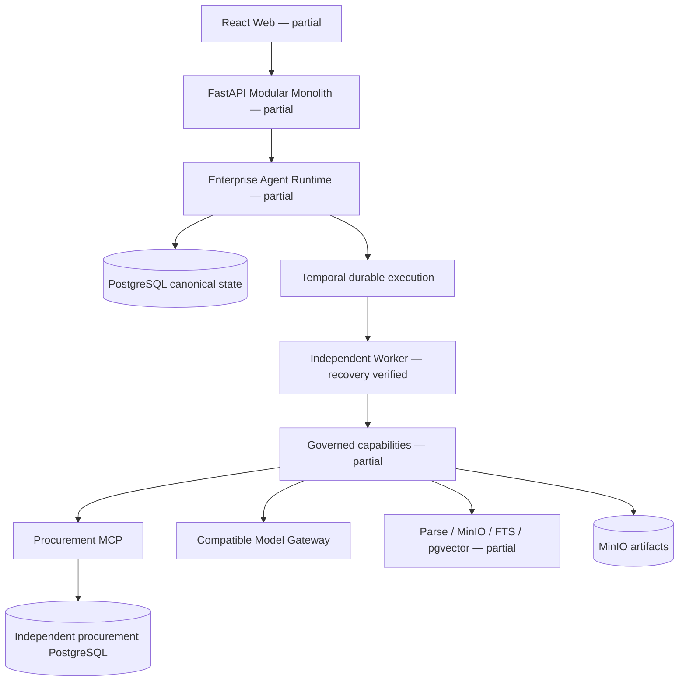

# Enterprise Agent Work Platform

企业级智能体工作平台，目标是让企业长任务在审批、权限、模型异常、Worker 崩溃和外部副作用条件下可靠执行。完整冻结需求保存在 `docs/spec/00-master-spec.md`。

**当前状态：实现中，未达到 Definition of Done，不可作为已完成平台发布。**

已建立 19 份 Spec 文档、需求矩阵、核心 Pydantic 契约、状态迁移、Policy/egress 规则、统一 Capability Registry/Executor、持久化任务预算与三类循环守卫、Redis Admission Control、加密密钥封装、PostgreSQL fencing、不可变 ExecutionSnapshot 与版本化 Plan、事务 Outbox、操作绑定的 durable HITL、本地身份/工作区/任务控制/审批/制品 API、耐久知识摄取、版本化会话摘要与项目记忆、六工具 Procurement MCP、模型 HTTP 网关，以及带 MinIO 隔离区和管理员确认的声明式 Skill 生命周期。启用的声明式 Skill 可在任务创建时生成不可变 Plan 和 TaskStep；根步骤为 READY，依赖步骤为 BLOCKED，证据提交会事务性解锁 DAG 后继并传播 Task 终态。任务创建事务通过 Outbox 启动真实 PlanExecutionWorkflow；独立 Worker 已能按快照版本、创建者角色、Policy、预算、循环守卫和 fencing 执行 MCP 读取步骤并写入 Evidence，也能为真实采购写入创建哈希绑定参数的审批请求，在 `WAITING_HITL` 持久等待，经 Outbox/Temporal Signal 恢复后只执行一次外部副作用。内置能力、Replan 与 Continue-As-New 编排，实时 Chat、完整 Trace、旗舰业务执行与其余验收仍待实现。



## 本地开发

要求 Python 3.12、Docker Desktop Linux Engine。当前验证环境为 Windows PowerShell。

```powershell
python -m venv .venv312
.\.venv312\Scripts\python.exe -m pip install -r requirements.lock.txt
.\.venv312\Scripts\python.exe -m pip install -e . --no-deps
.\.venv312\Scripts\python.exe scripts/configure_local.py
docker compose --env-file .env -f deploy/compose/infrastructure.yml up -d
.\.venv312\Scripts\python.exe scripts/migrate_local.py
.\.venv312\Scripts\python.exe scripts/verify_local.py
.\.venv312\Scripts\python.exe scripts/run_api_local.py
```

Web 开发与质量门：

```powershell
cd apps/web
pnpm install --frozen-lockfile
pnpm check
pnpm dev --port 55173
```

Web 已真实接入本地认证、工作区、会话/消息、任务控制、计划与持久步骤状态、Attempt/Evidence 计数、知识上传与摄取状态、Skill 隔离/确认/启停、MCP 注册/发现/健康检查/停用和能力目录、审批、制品下载及权限控制的审计 API。实时 Chat 页面仍明确显示运行时接口尚未接通，不生成模拟业务数据。

这条 Compose 命令启动开发基础设施，**不等于**最终要求的完整产品 `docker compose up`。PostgreSQL 端口 55432，采购数据库 55433，Redis 56379，MinIO 59000/59001，Temporal 57233，仅绑定本机。随机密码保存在忽略提交的 `.env`，不要提交或分享此文件。

## 验证

```powershell
.\.venv312\Scripts\python.exe -m ruff check src tests mcp_servers scripts
.\.venv312\Scripts\python.exe -m mypy src mcp_servers
.\.venv312\Scripts\python.exe scripts/verify_local.py
.\.venv312\Scripts\python.exe scripts/export_contracts.py
.\.venv312\Scripts\python.exe scripts/verify_migrations.py
.\.venv312\Scripts\python.exe scripts/verify_procurement_migrations.py
```

当前 pytest 包含真实 PostgreSQL fencing、计划 DAG 物化/依赖解锁/终态传播、Attempt/Evidence 权限查询、Capability 统一策略/Schema/幂等/副作用执行、任务预算并发预留与三类循环中止、真实 Redis 五类 Admission 限制及租约回收、事务 Outbox 并发租约与过期接管、复合工作区外键、append-only audit、不可变快照/计划的哈希往返、HITL 防绕过、真实 Temporal 审批及 pause/resume/cancel Signal、本地身份/会话/工作区/任务 API 隔离、任务快照绑定、乐观状态控制和管理员审批、真实 MCP 子进程及并发幂等测试。OpenAPI 输出在 `contracts/openapi.json`。模型结构修复测试使用 `tests/fakes/` 中的 HTTP transport；尚未验证真实模型服务。现有测试不是完整 Security / Failure / E2E / Evaluation Gate。结果写入 `work/verification/pytest.xml`。

## MCP 与 Skill

采购服务入口：`mcp_servers/procurement/server.py`。通过官方 Python SDK 的 stdio transport 运行，独立进程使用 `PROCUREMENT_DATABASE_URL`。平台注册使用固定的安全启动配置，只持久化环境变量引用；连接和健康检查会发现严格的六工具集合、归一化 CapabilityDescriptor 并保存不可变 Schema 快照。管理员权限、乐观版本、Schema 漂移隔离、审计和 Web 管理入口已经接入。真实 stdio Adapter 已通过统一 Capability Executor 的 Policy、Schema、预算、循环守卫、fencing 和重放边界调用读取能力；Outbox 启动的 Temporal 计划也已自动执行一个真实 MCP 读取步骤并提交 Evidence。此传输假定调用进程受信任；不能将服务直接作为已鉴权的公网接口发布。多能力旗舰 DAG 与外部副作用的审批编排仍待实现。

Skill ZIP 会保存到真实 MinIO 隔离区，并依次执行清单、Schema、SemVer、依赖、Capability、权限差异校验。工作区管理员可通过 API/Web 确认安装、启用和停用；PostgreSQL 保存不可变版本和可审计安装状态，Runtime 可查询已启用包并用其 DAG 创建不可变 Plan。完整 Plan 执行尚未完成，不能宣称“安装 Skill 后旗舰场景可用”。

完整声明式源包位于 `skills/supplier-risk/`，生成的确定性 ZIP 和 A/B/C 演示材料位于 `demo/supplier-risk/generated/`。通用 Skill→Plan 与 ExecutionSnapshot 绑定已经验证；该包声明的 knowledge、web、model、review 和 DOCX 内建 Capability 尚未全部落地，因此不能宣称旗舰场景已经可执行。

## 尚不可执行的产品流程

完整的模型配置与真实 BGE 摄取执行、已启用 Skill Plan 中 Capability 的 Runtime 执行、供应商旗舰任务提交与执行、Trace UI、Metrics UI、Golden Evaluation、完整硬故障和 backup/restore 验收仍未完成。登录、会话、知识上传、Skill/MCP 生命周期、任务控制、审批、审计读取和报告下载已经具备经过测试的组件链路，但还不能代表旗舰业务端到端验收。详情见 `FINAL_COMPLIANCE_REPORT.md` 与 `SPEC_COMPLIANCE_MATRIX.md`。

Temporal 容器配置参考官方 [PostgreSQL Compose 示例](https://github.com/temporalio/samples-server/blob/main/compose/docker-compose-postgres.yml)。业务事实仍属于平台 PostgreSQL；Temporal 数据库是基础设施状态。

## 当前工作目录与 RLS 验证

工程已复制到 `D:/Data/PyCharmData/Project/EnterpriseAgentWorkPlatform`。保留原 `.venv`（Python 3.11）和 IDE/Git 配置；项目开发使用 `.venv312`（Python 3.12）。当前后端完整测试集 152 项通过；前端 1 项组件测试、严格 TypeScript 和生产构建通过。

用户已授权创建 `runtime_rls_test` NOLOGIN 角色，仅授予 `public.task_runs` SELECT。真实数据库测试验证 A/B 双向隔离、缺少工作区时默认不可见，以及角色没有写权限和 evidence 读取权限。测试通过不代表 API 认证和整个系统隔离已验收。

## 实际模型连接验证

聊天模型使用 `MODEL_MODE / MODEL_BASE_URL / MODEL_NAME / MODEL_API_KEY`。知识摄取单独使用 `EMBEDDING_MODE / EMBEDDING_BASE_URL / EMBEDDING_NAME / EMBEDDING_API_KEY`，必须指向输出 1024 维向量的 BGE 服务，不能把聊天模型静默当作嵌入模型。完整 Activity 已通过测试专用 OpenAI-compatible HTTP 端点、真实 MinIO/PostgreSQL/Temporal 链路；当前 `.env` 尚未配置 EMBEDDING 项，因此真实 BGE 模型仍未验证。2026-09-08 再次探测本地聊天模型时 `127.0.0.1:8000` 无法连接，结果保持未验证。152 项组件与集成测试通过不等于完整产品验收。
